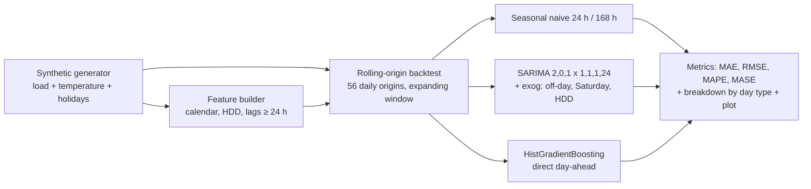
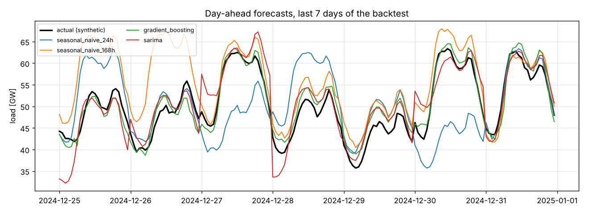

# energy-demand-forecasting

Day-ahead (24 h) forecasting of German-style hourly electricity load, comparing seasonal-naive baselines, SARIMA and gradient boosting in a leakage-free rolling-origin backtest.


> **Data note:** the load series is **synthetic**, produced by a deterministic generator (`seed=42`) shaped like the public German grid load: roughly 40–70 GW, a double daily peak, dips on weekends and nationwide holidays, a Christmas lull, and extra heating demand in cold weather. The numbers below show how the *methods* compare on this series. They are not claims about the real German grid.

## Problem

Grid operators and energy traders submit forecasts for every hour of the next day before the day-ahead auction closes. Errors cost money: they have to be balanced at short notice. A useful forecasting setup needs:

* honest evaluation (no peeking at data that wouldn't exist at forecast time),
* baselines strong enough that "the model is better" actually means something,
* breakdowns showing *where* a model fails (holidays, weekends).

## Approach



* **Calendar:** nationwide German holidays are computed in code (including the Easter-based ones like Karfreitag and Pfingstmontag), with no external holiday API.
* **No leakage:** each forecast is issued at midnight for hours 00–23. Every lag is at least 24 h old. A unit test masks the target for the forecast day and checks that no feature changes.
* **Backtest:** 56 origins (6 Nov – 31 Dec 2024). Each model only sees data before its origin. Models are re-trained every 7 origins. In between, the GBM uses fresh lags, and SARIMA re-runs its Kalman filter on the newest window with the fitted parameters (`results.apply`). This keeps the run around one minute without peeking.
* **SARIMA** is fitted on a 28-day sliding window, with daily seasonality s = 24. Weekly effects enter as exogenous dummies, because s = 168 is too slow to fit.
* **Temperature** is treated as a perfect weather forecast. In production it would come from a forecast provider, and real weather-forecast error would make every weather-aware model a bit worse.

## Results

Output of `make run` (56 daily origins = 1,344 hourly forecasts per model, 61.7 s in the build sandbox):

| model               | MAE [MW] | RMSE [MW] | MAPE [%] | MASE vs weekly naive |
|:--------------------|---------:|----------:|---------:|---------------------:|
| gradient_boosting   |  1,298   |   1,644   |   2.44   |  0.59 |
| sarima              |  1,914   |   2,583   |   3.67   |  0.87 |
| seasonal_naive_168h |  2,197   |   3,252   |   4.18   |  1.00 |
| seasonal_naive_24h  |  4,644   |   6,887   |   8.56   |  2.11 |

MAPE [%] by day type:

| model               | holiday | weekday | weekend |
|:--------------------|--------:|--------:|--------:|
| gradient_boosting   |   3.82  |   2.21  |   2.82  |
| sarima              |   6.92  |   2.95  |   4.97  |
| seasonal_naive_168h |  23.92  |   3.23  |   3.99  |
| seasonal_naive_24h  |   9.28  |   6.78  |  12.70  |



What this shows on the synthetic series:

* Gradient boosting cuts MAE by about 41 % compared with the weekly naive baseline (MASE 0.59). It also stays the most stable on holidays, because it gets an explicit holiday flag plus temperature.
* The weekly naive forecast is a strong baseline on ordinary days (3.2 % MAPE on weekdays) but falls apart on holidays (23.9 %). Last week's Christmas looks nothing like this week's.
* "Yesterday's load" (24 h naive) is the worst model overall. Mondays and Saturdays copy the wrong kind of day.
* SARIMA beats both naive models but trails the GBM. Its forecasts jump at midnight in the plot, a sign of the multi-step error building up from a single origin.

## How to run

```bash
make install      # pip install -r requirements.txt && pip install -e .
make test         # pytest (22 tests, ~3 s)
make lint         # ruff
make run          # full backtest incl. SARIMA (~1 min) -> reports/metrics.csv, forecasts.csv, last_week.png
make quick        # 14 origins, no SARIMA (~5 s)
```

CLI options: `python -m energy_forecast.run --days 28 --no-sarima --out reports`.

## Project structure

```
src/energy_forecast/
  calendar.py   # Easter algorithm + German nationwide holidays
  data.py       # deterministic synthetic load/temperature generator
  features.py   # calendar, weather and lag features (lags >= 24 h)
  models.py     # SeasonalNaive, SarimaForecaster, GradientBoostingForecaster (common fit/predict API)
  backtest.py   # rolling-origin backtest with refit schedule
  metrics.py    # MAE, RMSE, MAPE, MASE
  run.py        # end-to-end CLI: generate -> backtest -> report + plot
tests/          # 22 pytest tests: calendar, generator, leakage, metrics, models
docs/           # figure used in this README
```

## What I'd do next

* Plug in real data: ENTSO-E / SMARD hourly load plus DWD temperature, with a `scripts/download_data.py`.
* Add probabilistic forecasts (quantile GBM, P10/P90) and score them with pinball loss. Balancing risk depends on the tails.
* Add regional holidays (Fronleichnam, Allerheiligen) weighted by each state's share of load.
* Use realistic weather-forecast error instead of perfect temperature, to measure how much accuracy depends on the weather input.
* Try a global model per horizon hour, or LightGBM with tuned hyperparameters (time-series CV with Optuna).

## Interview notes

* **Why rolling-origin and not a random split?** Time series are autocorrelated. A random split leaks the future into training and inflates scores. Each origin here only sees its past, the same as in production.
* **Why baselines first?** MASE against the weekly naive turns "2.4 % MAPE" into "41 % better than copying last week". That is the number a stakeholder cares about. The day-type breakdown shows *why*: holidays are where naive methods fail.
* **Leakage guard as a test:** `test_no_feature_uses_future_or_same_day_target` masks the forecast day and asserts that the features stay identical. It guards against the most common time-series bug.
* **SARIMA trade-off:** s = 168 would capture the week but is very slow to fit. So I used s = 24 plus exogenous weekend/holiday dummies, and refit weekly with Kalman-filter updates in between. A single fit takes about 8 s, so refitting at all 56 origins would take about 7.5 min; the weekly schedule brings the whole run down to about 1 min.
* **Direct vs recursive:** the GBM predicts each hour directly from information known at the origin. There is no recursion, so errors don't build up over the 24 steps, unlike SARIMA's multi-step forecast.
